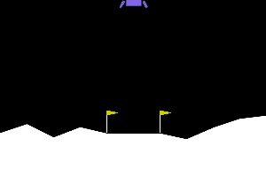
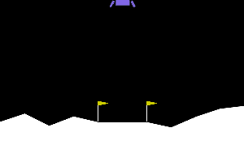

# Rocket Lander RL

Reward shaping, reward hacking and robustness for a reinforcement-learning rocket lander (Gymnasium `LunarLander-v3`, PPO via Stable-Baselines3).

> **Status:** full experiment (4 reward designs × 5 seeds × 1M steps, 100 evaluation landings per model, wind/gravity stress tests) is running. The clips below are previews from finished models; final results, charts and the "fixed" agent will be added here.

| 1. Random actions: crashes | 2. Trained agent: lands on the pad | 3. Hover hack: never lands |
|---|---|---|
|  |  |  |
| 20/20 crashed, mean score −163 | **20/20 landed on pad, mean score 259** (solved ≥ 200) | 19/20 hovered until the 1,000-frame timeout, mean score 11 |

Clip 3 shows **reward hacking**: paying "+1 for every frame upright and slow" makes hovering worth up to 1,000 points, versus +100 for landing, so the agent learns never to land. Preview numbers: 20 evaluation episodes, seed-0 models, scored with the built-in reward only.

## Run it yourself
```powershell
git clone https://github.com/cloudynirvana/rocket-lander-rl.git
cd rocket-lander-rl
python -m venv .venv; .\.venv\Scripts\Activate.ps1
pip install -r requirements.txt
python -m pytest -q
python experiments\run_all.py --steps 100000 --seeds 1 --episodes 20   # quick run (~5 min)
```
