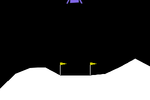
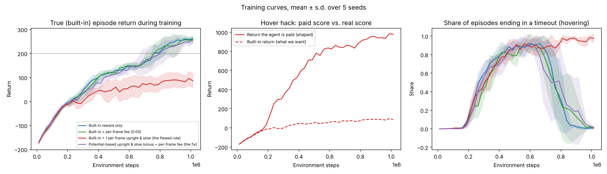
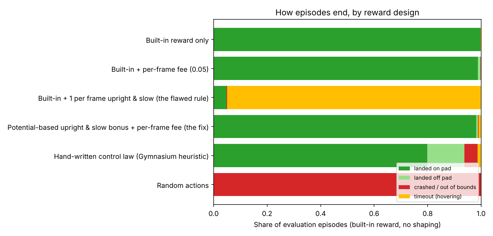
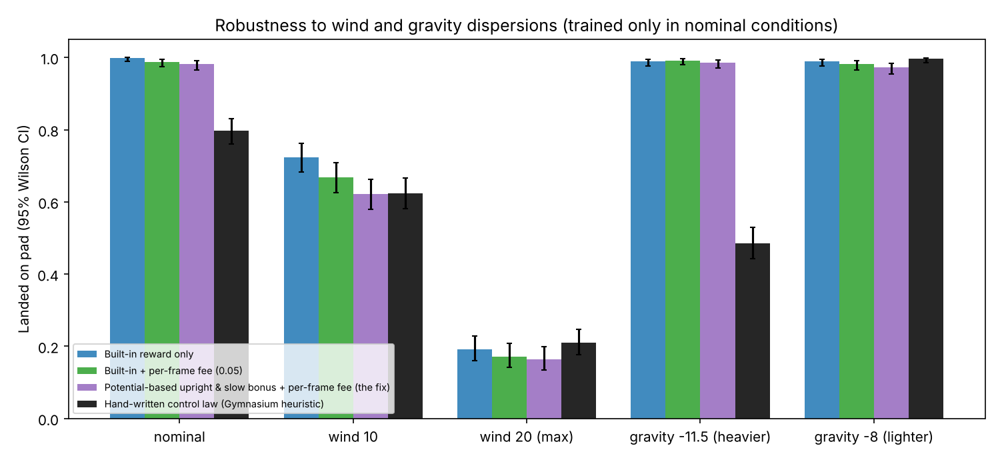

# Rocket Lander RL

**Reward shaping, reward hacking and robustness for a reinforcement-learning rocket lander.**
PPO agents (Stable-Baselines3) learn to land in Gymnasium's `LunarLander-v3` under four reward designs, five seeds each. Every agent is judged on the environment's **built-in reward only**, so no reward rule can flatter its own score. The agents are then stress-tested against a hand-written control law under wind and gravity dispersions.

| Random actions: crash | Trained agent: lands | Hover hack: never lands | Fixed reward: lands |
|---|---|---|---|
|  |  |  |  |

## Key findings

500 evaluation landings per design (5 seeds × 100 fixed episode seeds), built-in reward, no shaping:

| Reward design | Landed on pad (95% CI) | Hovered to timeout | Mean score | Solved (≥ 200) |
|---|---|---|---|---|
| Built-in reward only | **99.8%** (98.9–100) | 0.2% | 263 | 99.4% |
| Built-in + per-frame fee (0.05) | 98.8% (97.4–99.4) | 0.0% | 264 | 99.4% |
| **+1 per frame upright & slow** (flawed rule) | **4.8%** (3.2–7.0) | **95.0%** | **−29** | 0.4% |
| Potential-based version + per-frame fee (the fix) | 98.2% (96.6–99.1) | 1.0% | 259 | 98.2% |
| Hand-written control law (Gymnasium heuristic) | 79.8% (76.1–83.1) | 1.4% | 244 | 91.4% |
| Random actions | 0.0% | 0.0% | −185 | 0.0% |

1. **The trained agent beats the hand-written controller in nominal conditions:** 99.8% vs 79.8% on the pad.
2. **The flawed rule causes reward hacking in all 5 seeds.** "+1 for every frame upright and slow" pays up to 1,000 points for hovering versus +100 for landing. Agents learned to hover: 95% of episodes timed out, and on-pad landings fell to 4.8%. The middle chart below shows the paid score climbing towards 1,000 while the real score stalls.
3. **Paying for *becoming* upright and slow, instead of *being* there, removes the hack.** The shaping term is potential-based (Ng, Harada & Russell, 1999), so it cannot change which policy is optimal, and a small time fee is added. On-pad landings recover to 98.2%. That is slightly below the unshaped agent's 99.8% (Fisher exact test on pooled episodes, *p* = 0.02), so the fix removes the hack at a small cost.
4. **Every agent passes through a hovering phase.** Around 0.4–0.6M steps, about 90% of episodes end in a timeout for *all* designs (right chart). Hovering is the natural way station between crashing and landing. The flawed rule turns that way station into the destination.
5. **Robustness is mixed, and that's the honest result.** Trained only in nominal conditions, the RL agents handled **heavier gravity far better** than the control law (99% vs 49% on the pad) and moderate wind as well or better (62–72% vs 62%). Under maximum wind, *everything* failed (16–21% on the pad). Neither approach is robust to large disturbances it was not designed for.
6. **The time fee did not speed up landings much** (mean 297 vs 312 frames). The built-in fuel cost already discourages dawdling.





## How it works

| File | Role |
|---|---|
| `src/lander/envs.py` | Wrappers: `OutcomeTracker` (records how each episode ended, using the built-in reward), `TimeFee`, `HoverBonus` (the flawed rule), `PotentialHoverBonus` (the fix), `EpisodeLogger` |
| `src/lander/train.py` | PPO with RL Baselines3 Zoo hyperparameters for LunarLander; 16 parallel environments, 1M steps |
| `src/lander/evaluate.py` | Built-in-reward evaluation, wind/gravity conditions, hand-written control law, Wilson confidence intervals |
| `experiments/run_all.py` | Train all designs × seeds in parallel, evaluate, plot, record GIFs |
| `results/models/` | All 20 trained agents (re-evaluate without retraining) |
| `tests/` | Shaping never leaks into the true return; the time fee charges every frame; potential shaping telescopes; baselines behave as expected |

**Wrapper order matters.** The outcome tracker sits *inside* the shaping wrapper, so the logged "true" return is always the built-in one, whatever the agent is paid. A unit test enforces this.

## Methodology notes
- 5 independent training seeds per design. Evaluation uses fixed episode seeds that are disjoint across models; the control law flies the same 500 episodes.
- Proportions get 95% Wilson intervals over pooled episodes, which understates seed-to-seed variation. Per-seed results are in `results/evaluation.json`. For example, hover-hack seeds landed on the pad 22%, 2%, 0%, 0% and 0% of the time.
- The time-fee and fix designs were not tuned. They use a 0.05 fee and the guide's thresholds (|angle| < 0.2 rad, speed < 0.2 in observation units).
- The GIFs show one representative episode from the seed with the highest rate of the relevant outcome (`media/gif_sources.json`). The random clip shows the first crash from a seeded random policy.

## Reproduce

**Windows PowerShell**
```powershell
git clone https://github.com/cloudynirvana/rocket-lander-rl.git
cd rocket-lander-rl
python -m venv .venv; .\.venv\Scripts\Activate.ps1
pip install -r requirements.txt
python -m pytest -q                                                      # 9 tests
python experiments\run_all.py --stages eval gifs                         # re-evaluate the 20 included agents (~10 min)
python experiments\run_all.py                                            # retrain everything (~1 h on 4 cores)
explorer media
```
If Box2D fails to install with an error mentioning `swig`, install `swig` first (it is listed in `requirements.txt`).

## References
- Ng, A. Y., Harada, D., & Russell, S. (1999). Policy invariance under reward transformations: theory and application to reward shaping. *ICML*.
- Schulman, J. et al. (2017). Proximal Policy Optimization Algorithms. arXiv:1707.06347.
- Raffin, A. (2020). RL Baselines3 Zoo. GitHub repository.
- Project idea adapted from Hari (@harixganesh), *Training an AI to land a rocket with reward shaping*.
